Hì, Xin chào nhé!!!

Mình là **Beru**, làm ở Easy AI, viết linh tinh ở [beru.io.vn](https://beru.io.vn). Thích dựng công cụ cho dev, agent skill cho Claude Code và mấy thứ local-first.

## 📊 Analytics

  
  

  

## 📌 Dự án

  
  
  
  

Các thẻ thống kê được GitHub Actions tạo lại mỗi ngày (chỉ tính repo public).
